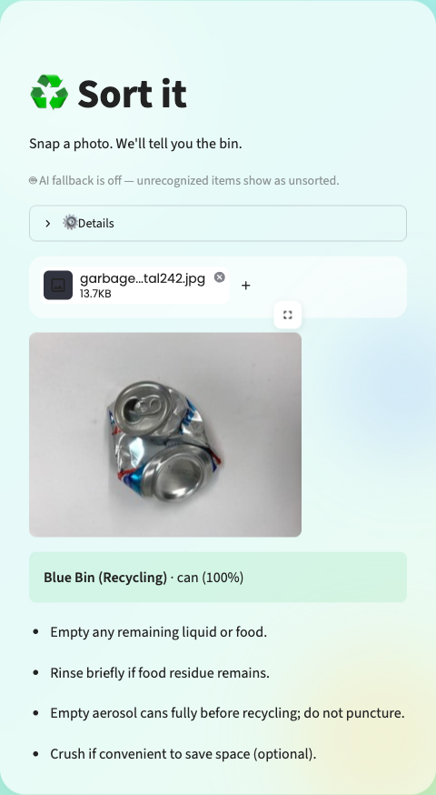
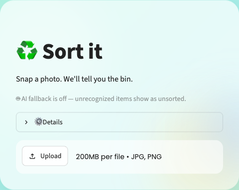
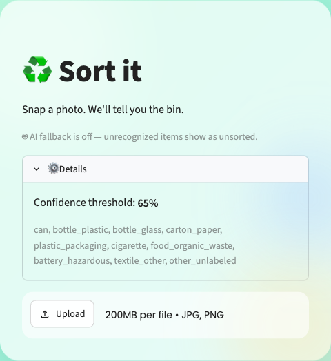
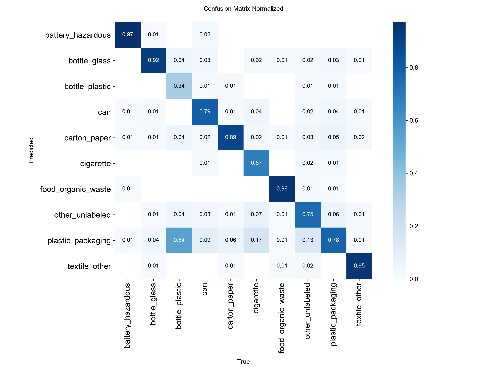

# ♻️ Sort It — AI Waste-Sorting Assistant

**Take a photo of one item → a locally-run computer vision model identifies it → get the correct bin and prep steps, instantly.**

When the model isn't confident, it doesn't guess — it hands the photo to a vision LLM (Claude) for a second opinion, and logs the case so the model can be retrained on it later. It's a small app, but it's built the way a production ML feature should be: a trained model, a human-editable rules layer, a fallback path, test coverage, and a feedback loop for improving over time.

<p align="center">
  
</p>

---

## See it in action

| Upload a photo | Get a confident result | Check the config |
|---|---|---|
|  |  |  |

In this example, a photo of a crushed can is classified as `can` with **100% confidence** entirely by the local model (no API call, no network round-trip) and immediately mapped to the right bin and prep steps.

---

## How it works

```
Item photo
    │
    ▼
Local YOLOv8-cls model (fine-tuned on ~19k images, 10 categories)
    │
    ├─ confidence ≥ threshold AND category known ──► rules.yaml lookup ──► bin + steps
    │
    └─ confidence < threshold OR category unknown ──► Claude (vision) ──► bin + steps
                                                              │
                                                              ▼
                                                     logged to logs/fallback_log.csv
```

The model's only job is "what is this." Everything about *what to do* with that answer lives in `rules.yaml`, completely separate from the model — that's what lets the whole app be retargeted to a different city's recycling program by editing one YAML file, with zero retraining or code changes.

**Why a fallback instead of just a bigger model?** Because waste-sorting rules are local and change — a plastic #5 might be curbside-recyclable in one city and not another. Baking that into model weights means retraining every time a rule changes. Keeping it in a human-edited `rules.yaml`, with an LLM fallback plus logging for the cases the local model doesn't know, means the system improves and adapts without ever touching the model.

---

## Model performance

A YOLOv8n classification head fine-tuned for 40 epochs on **~19,000 images across 10 categories**, merged from three public datasets ([TACO](https://github.com/pedropro/TACO), [RealWaste](https://github.com/sam-single/realwaste), and Kaggle's Garbage Classification set):

- **85.4%** top-1 validation accuracy
- **98.9%** top-5 validation accuracy

<p align="center">
  
</p>

Per-class accuracy is the more honest number than overall top-1 — a model that's 95% accurate but never gets `bottle_plastic` right fails silently in the app. The matrix above shows exactly that kind of gap: `battery_hazardous` (0.97), `food_organic_waste` (0.96), and `textile_other` (0.95) are excellent, while `bottle_plastic` (0.34) is the weakest class, mostly confused with the visually similar `plastic_packaging`. That's expected and tracked, not hidden — it's exactly the kind of case the Claude fallback and `logs/fallback_log.csv` exist to catch and correct over time.

---

## What this project demonstrates

- **End-to-end ML pipeline** — dataset curation and merging across three heterogeneous sources, class balancing, training, and per-class evaluation (not just aggregate accuracy).
- **Production-minded architecture** — a strict separation between *what the model predicts* and *what the app does about it*, so business logic (recycling rules) never lives inside model weights.
- **A real fallback strategy** — low-confidence predictions degrade gracefully to a vision LLM instead of returning a wrong answer with false confidence, and every fallback is logged to build the next training set.
- **Test coverage** — 21 unit tests across the rules engine, LLM response parsing, and error handling, all of which run with no model weights or dataset required.
- **A clean, functional UI** — built in Streamlit, intentionally minimal and fast to use on a phone.

---

## Tech stack

`Python` · `Ultralytics YOLOv8` (classification) · `PyTorch` · `Streamlit` · `Anthropic Claude` (vision fallback) · `pytest`

---

## Quickstart

```bash
# 1. Use Python 3.11/3.12 in a virtualenv
python -m venv .venv && source .venv/bin/activate
pip install -r requirements.txt

# 2. Add your Anthropic API key (optional — only needed for the AI fallback)
cp .env.example .env   # then edit .env and set ANTHROPIC_API_KEY

# 3. Run it — a trained model (weights/best.pt) is already included
streamlit run app/streamlit_app.py
```

Then open the local URL Streamlit prints, upload a close-up photo of one item, and see the result.

Run the test suite any time with:

```bash
pytest tests/
```

---

## Project structure

```
waste_sorter/          core logic — classifier, rules engine, LLM fallback, config, logging
app/streamlit_app.py    the demo UI
rules.yaml              bin names + prep steps per category (edit this to retarget a city)
config.yaml              runtime config — model path, confidence threshold wiring, LLM settings
scripts/                 dataset preparation + training scripts
data/                    category mappings + prepared classification dataset
weights/best.pt          trained model weights
tests/                   unit tests (no model/dataset required to run)
```

---

<details>
<summary><strong>Dataset & category design</strong> (click to expand)</summary>

<br>

[TACO](https://github.com/pedropro/TACO) is a detection/instance-segmentation dataset: every annotation is a bounding box around one litter item in a scene, labeled with one of ~60 fine-grained categories (e.g. "Drink can", "Clear plastic bottle", "Aluminium foil"). That's too fine-grained (and imbalanced) to train directly, so `data/category_map.yaml` collapses those labels into the 10 practical categories `rules.yaml` actually handles:

| Category | Bin intent |
|---|---|
| `can` | Metal recycling |
| `bottle_plastic` | Plastic recycling |
| `bottle_glass` | Glass recycling |
| `carton_paper` | Paper/cardboard recycling |
| `plastic_packaging` | Soft/mixed plastic recycling |
| `cigarette` | Trash (never recyclable) |
| `food_organic_waste` | Compost/organics |
| `battery_hazardous` | Hazardous waste / e-waste drop-off |
| `textile_other` | Textile recycling/donation |
| `other_unlabeled` | General trash / needs manual judgment |

TACO alone leaves some categories thin (`battery_hazardous`, `food_organic_waste`, `textile_other` each map from only one or two TACO fine labels), so two more sources were merged in via `scripts/prepare_imagefolder_dataset.py`:

- **RealWaste** — 9 classes, ~4,700 images
- **Garbage Classification** (Kaggle) — 12 classes, ~15,000 images, capped per-category to avoid `textile_other`/`clothes` dominating the merged set

This mapping is a starting point, not gospel — if you add or rename a category, edit `data/category_map.yaml` **and** `rules.yaml` together, then re-run `prepare_dataset.py` and retrain.

</details>

<details>
<summary><strong>Retraining or extending the model</strong> (click to expand)</summary>

<br>

1. **Get TACO and download its images:**
   ```bash
   git clone https://github.com/pedropro/TACO.git data/raw_taco
   cd data/raw_taco && python3 download.py   # pulls images from Flickr — slow, some links will be dead
   cd ../..
   ```

2. **Build the classification dataset:**
   ```bash
   python scripts/prepare_dataset.py --taco-root data/raw_taco --output-dir data/classification
   ```

3. **Merge in RealWaste and/or Garbage Classification** (optional, for thin categories):
   ```bash
   python scripts/prepare_imagefolder_dataset.py \
     --source-dir data/realwaste/extracted/realwaste-main/RealWaste \
     --category-map data/category_map_realwaste.yaml \
     --source-tag realwaste \
     --output-dir data/classification \
     --val-ratio 0.15

   python scripts/prepare_imagefolder_dataset.py \
     --source-dir data/garbage_classification \
     --category-map data/category_map_garbage_classification.yaml \
     --source-tag garbage_classification \
     --output-dir data/classification \
     --val-ratio 0.15 \
     --max-per-category 2000
   ```

4. **Train:**
   ```bash
   rm -f data/classification/train.cache data/classification/val.cache
   python scripts/train_classifier.py --data-dir data/classification --epochs 40
   ```
   Watch per-class accuracy, not just overall top-1 — then copy the resulting
   `runs/classify/waste_sorter/weights/best.pt` to `weights/best.pt`.

5. **Before trusting it**, test on 20-30 photos taken the way you'd actually use the app (close-up, held item, your own lighting) — TACO's photos are outdoor litter on the ground, which is a meaningfully different visual domain from a staged close-up.

6. **Tune `confidence_threshold`** in `rules.yaml` once you can see real fallback-vs-correct rates on your own data. Lower means fewer LLM calls but more wrong local answers slipping through; higher means the opposite.

7. **Periodically review `logs/fallback_log.csv`**, especially rows with `is_new_category=True` — that's the "what's missing" list, and the most common misses become the next training classes.

</details>

<details>
<summary><strong>Known limitations (by design)</strong> (click to expand)</summary>

<br>

- **Single item only.** One centered, close-up photo of one thing — not a scattered scene. Multi-item detection is a different, harder problem (full-scene detection, not classification) and is intentionally out of scope for v1.
- **Rules are hand-authored, not AI-guessed.** The app never asks an LLM to invent local recycling law from scratch — `rules.yaml` is yours to write and correct for your actual city's program.
- **It won't be right about everything on day one.** That's what the fallback + logging loop is for. A persistently high fallback rate is a signal to add training classes, not something to paper over.
- **`bottle_plastic` is a known weak class** (34% recall, see confusion matrix above) — it's frequently confused with `plastic_packaging`, which is both visually similar and numerically dominant in the training set.

</details>

---

*Bin names and prep steps in `rules.yaml` currently follow the City of Ottawa's curbside program — swap them for your own city's "what goes where" rules before relying on this for real sorting.*
